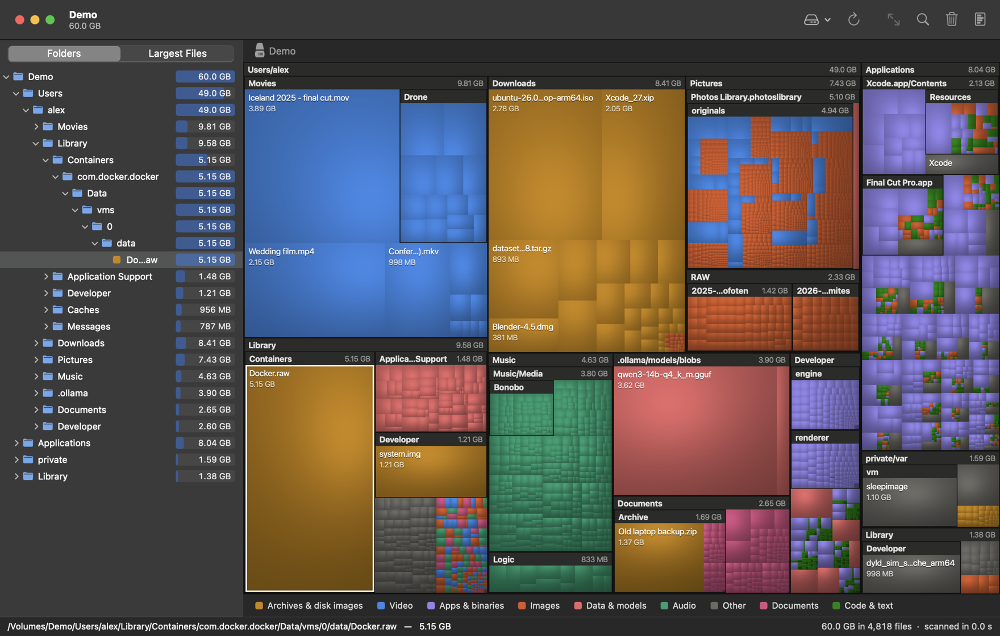

# DiskMap

The macOS equivalent of [WinDirStat](https://windirstat.net): see where your
disk space went, as a treemap, in seconds.

Every rectangle is a file, sized by the space it takes and coloured by what it
is. Folders are the frames around them. The big rectangles are where your
space went.

- **Fast.** A full scan of a 1 TB disk with 9.5 million files takes about
  40 seconds on an M-series Mac.
- **Honest numbers.** Hard links and APFS clones are counted once, and the
  disk summary compares what the scan found with what macOS says is used.
- **Small.** Swift and AppKit for the window, C for the scanner. No
  dependencies, about 2 MB.

## Install

    curl -fsSL https://raw.githubusercontent.com/kddige/diskmap/main/install.sh | sh

This downloads the latest release and puts `DiskMap.app` in `/Applications`.
It needs macOS 15 or later and runs on Apple silicon and Intel.

DiskMap is not notarized by Apple, because that needs a paid developer
account. The installer avoids the "cannot be opened" warning by downloading
with `curl`. If you download the zip from the
[releases page](https://github.com/kddige/diskmap/releases) in a browser
instead, clear the quarantine flag yourself before opening it:

    xattr -dr com.apple.quarantine /Applications/DiskMap.app

To uninstall, delete `/Applications/DiskMap.app`.

## Full Disk Access

Without it macOS hides Mail, Messages, Safari data, other apps' containers and
similar folders, and their space shows up as "not found by the scan". Grant it
in System Settings > Privacy & Security > Full Disk Access (the welcome screen
has a button that opens that pane), then rescan.

macOS ties the grant to the exact build. If scans come up short after
updating DiskMap, remove it from that list and add it again.

## Using it

| | |
|---|---|
| Click | select a file or folder |
| Double-click, ⌘↓ | zoom into a folder |
| ⌘↑, ⇧⌘↑ | zoom out, zoom to the top |
| ⇧⌘D, ⇧⌘H, ⌘O | scan Macintosh HD, the home folder, a chosen folder |
| ⌘R | rescan (stop while scanning) |
| ⌘I | disk summary: what the scan found against what macOS says is used |
| ⇧⌘R | reveal in Finder |
| ⌘⌫ | move to Trash (asks first) |
| ⌘C | copy path |

Right-click works in the map and in both lists.

## How sizes are counted

Sizes are space on disk, not file length. Each of these is counted once:

- hard links to the same file;
- APFS clones (Finder copies, `cp -c`, build caches). The data is counted on
  the original and the copies show only what they do not share. A copy that
  was modified after cloning is counted in full, so the total can be slightly
  high;
- other mounted volumes, which are skipped.

## Command line

`dmscan` is the same scanner without the window. It ships inside the app:

    /Applications/DiskMap.app/Contents/MacOS/dmscan ~ --depth 3 --min-gb 1
    /Applications/DiskMap.app/Contents/MacOS/dmscan / --top 20 --files 50

Options: `--depth N`, `--top N` (entries per folder), `--min-gb X`,
`--files N` (largest files), `--threads N`.

## Build from source

Needs Xcode 16 or later.

    git clone https://github.com/kddige/diskmap.git
    cd diskmap
    ./build-app.sh              # builds and signs DiskMap.app here
    ./build-app.sh --install    # also copies it to /Applications
    swift test

`build-app.sh` signs with the first code-signing identity in your keychain, so
a Full Disk Access grant survives rebuilds; set `CODESIGN_IDENTITY` to pick
another. With no identity it signs ad hoc.

Contributing: see [AGENTS.md](AGENTS.md) for the layout, the commit format and
how releases are cut.

## License

[MIT with the Commons Clause](LICENSE). Use it, change it and share it freely,
at home or at work. You may not sell it.
